# NewYearPicturePromotion
非遗年画宣传系统 亮点:DeepSeek 流式 AI 对话、ECharts运营分析、年画作品与工艺流程数字化展示、图片/视频/图文资源审核、文创商城与订单状态流转、评论收藏关注; 角色：用户、传承人、管理员；

所有源码均本人开发，项目是前后端分离的，所有的项目都具备了完整的业务逻辑，不仅仅局限于基础的增删改查（CRUD）操作，系统亮点众多。

本文注重于计算机毕业设计选题指导，列出题目均有源码， 大家可以去【公众号】(毕业终点站)获取或者加我【qq】(2112698948)提意见(别忘记Star哟)。备注：git

声明：仅用于学习使用，请勿用于任何商业行为！

1.系统非商用，非开源，非无偿。

2.由本人开发，如需源码，请联系以下方式，qq:2112698948。

3.项目有很多，并未全部上传，如果未找到想要的，可直接咨询。

# 非遗年画文化传承与文创推广平台

> 一个把年画「看、读、买」串起来的平台：前台看作品和工艺、进数字资源馆、逛文创商城、和 AI 聊年画；传承人在后台传作品、传资源、上商品、发货回评；管理员审资质、审内容、看数据。

## 一、项目简介

年画这类非遗项目有个共同的尴尬：作品散在传承人手里，展览办完就收进箱子；想了解的人只能看几张手机照片，想买文创得跑去线下店，买完也不知道画是谁做的、工序有几步。传承人这边更难，作品、视频、商品、订单、评价各摊一处，靠微信和本子记。

平台按「内容—交易—互动」三层把事理顺：

- 三个身份一个登录口：管理员、用户、传承人，登录后按角色进不同界面；
- 内容层：年画项目 → 流派 → 作品 → 工艺流程，再挂上图片、视频、图文三类数字资源，资源要审核通过才对外展示；
- 交易层：作品关联文创商品，浏览、加购物车、选地址、下单、支付、发货、确认收货、评价，订单状态按规则流转，取消待支付订单会把库存加回去；
- 互动层：作品评论、商品评价、传承人回复、收藏作品、关注传承人，外加一个接 DeepSeek 的 AI 对话。

## 二、技术栈

| 层 | 技术选型 |
| --- | --- |
| 后端 | Java 17、Spring Boot 3.3.1、Spring MVC、MyBatis-Plus、MySQL、JWT、SSE 流式通信 |
| 前端 | Vue 3、Vite、Element Plus、Vue Router、Pinia、Axios、ECharts |
| AI | DeepSeek API、流式回复、多轮上下文、历史会话管理 |
| 架构 | B/S、MVC、前后端分离、网页前台 + 管理后台、管理员 / 传承人 / 普通用户三角色 |

## 三、系统亮点

**1. DeepSeek 流式问答，能接着上一句聊**
用户可以在左侧建多个会话（截图里是「模拟-办公室年画展陈建议」和「模拟-杨柳青年画入门」），提问后后端以 `text/event-stream` 一段段往回推，前端边收边显示，不用等整段生成完。每次提问都带当前会话的历史消息，所以能追问；第一次提问会拿问题内容当会话标题，省得手动命名。问「如果只买三类东西，优先买什么？」，回答会给到「装裱版挂画撑主题、笔记本礼盒或帆布包展示纹样、DIY 材料包做体验」这种带优先级的建议，不是泛泛而谈。

**2. 年画作品与工艺流程的数字化展示**
内容不是堆图，而是有层级：5 个年画项目（梁平、凤翔、佛山、朱仙镇、武强，标了所属地区和保护级别）、6 个流派（古版质朴派-陕西凤翔、金碧辉煌派-广东佛山、粗犷豪放派-河南朱仙镇、手绘填色派-四川绵竹、纯木版套色派-江苏苏州、木版套印彩绘派-天津杨柳青），作品挂在项目和流派下面。详情页一屏能看到作品大图、流派标签、传承人、所属项目、年代、产地、浏览量、工艺特点和文化背景，往下就是评论区。

**3. 传承人入驻与资源审核**
传承人注册后要提交资质，管理员在「传承人审核」里看账号、手机号、擅长流派、从艺年限和资质证书，通过后才能进作品、资源、商品模块。数字资源上传时选类型（图片 / 视频 / 图文）、关联作品、填详情和封面，先落在待审核；管理员通过后资源才在资源馆露面，驳回会写备注 —— 截图里那条被驳回的原因是「图片清晰度不足，请重新上传高清版本」，传承人在自己的资源列表里能直接看到这句话。

**4. 文创商城与订单状态流转**
文创商品挂在年画作品上，比如「年画艺术挂画（装裱版）」关联的是佛山门神·加官进爵，规格 50cm×70cm 实木框装裱，售价 358 元、库存 29、销量 8。下单时写入订单和明细快照、扣库存、清购物车；订单围绕待支付、已支付、已发货、已收货、已退款、已取消六个状态走，用户端一个 tab 对应一个状态，取消待支付订单会把库存恢复。订单监管页把 28 笔订单拆成 12 已支付、6 已收货、5 已发货、2 已退款、3 已取消、0 待支付，加起来正好 28。

**5. 评论、收藏与关注**
作品评论带传承人回复（截图里赵丽琴留言后，传承人当天回复了「朱仙镇年画被认为是中国木版年画的鼻祖」），商品评价是 5 分制，传承人在评价管理里逐条回，回过的显示「修改回复」、没回的显示「未回复」，一眼能看出哪些还没处理。用户侧还有收藏作品和关注传承人两个动作，收藏按钮就在详情页。

**6. ECharts 运营分析**
统计报表把近 12 个月的订单量和销售额画成双线（销售额走右轴，量级差得开所以不挤在一起），下面两张横向条形图分别是热门年画排行（按浏览量）和热销商品排行（按销量）。管理员不点进具体订单，也能知道哪幅画被看得多、哪个商品卖得动。

## 四、功能模块

### 4.1 普通用户（网页前台）

- **账号**：注册登录、首页浏览、公告查看、个人资料与密码修改
- **年画艺术馆**：按流派筛选、关键词搜索、作品详情、工艺特点与文化背景、制作工艺步骤
- **数字资源馆**：按图片 / 视频 / 图文分类浏览，查看高清图、播放视频、阅读图文
- **互动**：关注传承人、收藏作品、发表评论
- **文创商城**：商品分类筛选、商品详情、购物车、收货地址管理
- **交易**：提交订单、模拟支付、取消待支付订单、确认收货、商品评分与评价、我的订单与订单详情
- **AI 对话**：新建与删除会话、流式对话、历史消息查看

### 4.2 传承人端

- **入驻**：注册、提交认证材料、查看审核状态、维护个人资料
- **作品管理**：维护作品图片、所属项目、流派、年代、产地、工艺特点与文化背景
- **数字化资源**：上传图片 / 视频 / 图文资源，关联作品，查看审核结果与备注
- **文创商品**：发布商品，维护规格、价格、库存和上下架
- **订单**：查看销售订单、处理发货、确认退款
- **互动**：年画评论回复、商品评价回复

### 4.3 管理员端

- **用户与资质**：用户账号管理、传承人资质审核
- **内容基础数据**：年画项目管理、年画流派管理、年画作品管理、工艺流程管理
- **资源**：数字化资源管理、资源审核与审核备注
- **商品与订单**：文创商品分类管理、商品管理、销售订单监管、订单明细管理
- **互动管理**：年画评论、商品评价、作品收藏与传承人关注记录
- **数据**：数据看板、热门年画排行、热销商品排行、订单与销售额趋势、资源类型分布
- **系统**：公告管理、操作日志、个人信息与密码修改

## 五、系统截图

### 5.1 登录入口

三个身份挂在同一个登录页上，点卡片切换管理员 / 用户 / 传承人，填账号、密码、验证码登录。源文档未提供独立的系统总览图，首图即登录页。

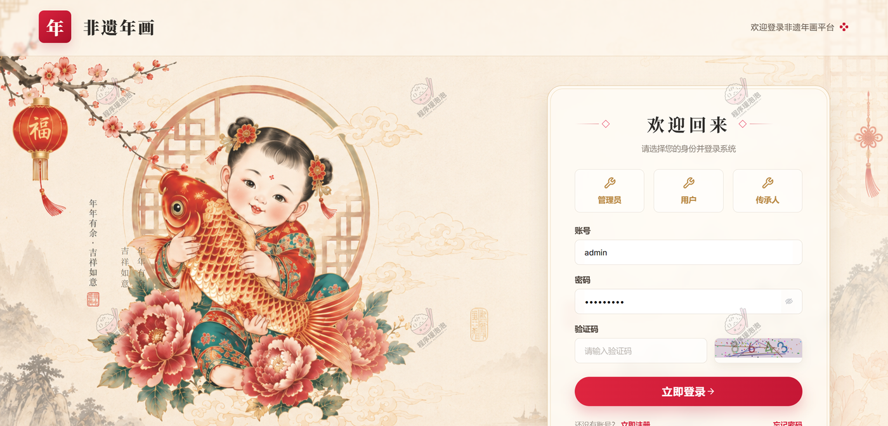

### 5.2 普通用户（网页前台）

**首页**：顶部导航是首页、年画赏析、数字资源、文创商城、AI 对话，右边是搜索、购物车、收藏夹和头像。首屏左边一句「传承千年 笔墨绘祥瑞」配两个入口（探索年画馆、传承人入口），右边轮播一幅作品，图上标着《连年有余》。

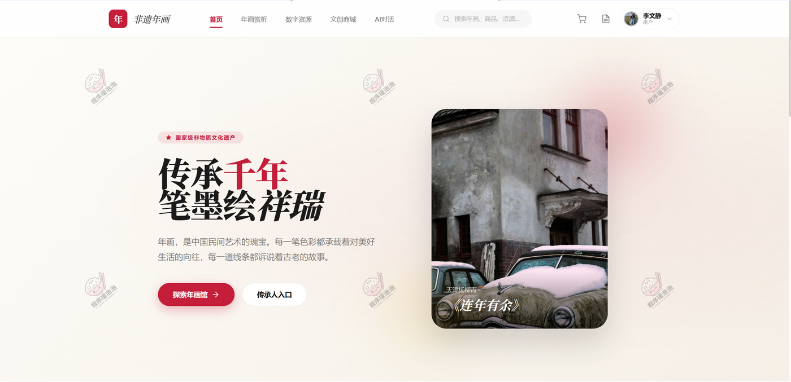

**年画艺术馆（年画赏析）**：顶部一行流派标签做筛选（全部加六个流派），右侧能按作品名或传承人搜。卡片是作品图 + 名称 + 传承人，左上角压着流派标签，梁平门神·立刀、凤翔泥塑年画·挂虎、佛山门神·加官进爵、朱仙镇门神·神荼郁垒四幅并排。

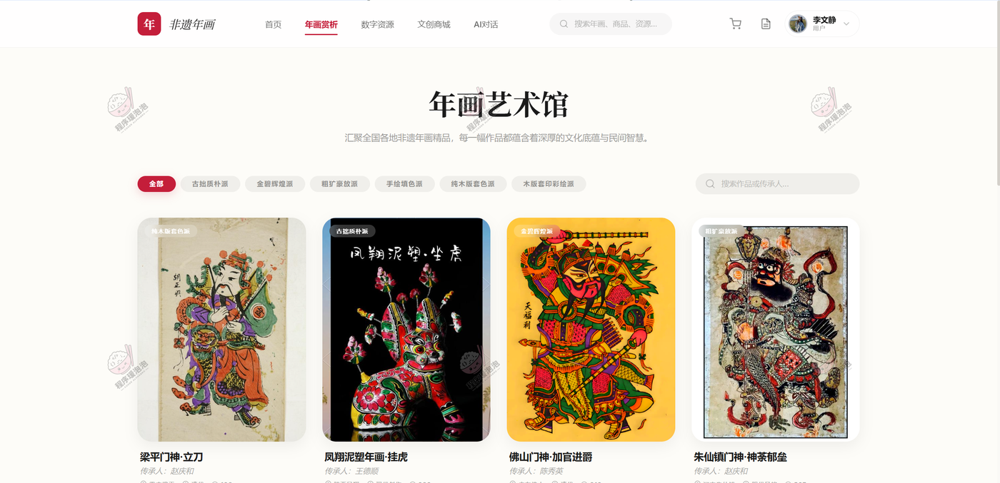

**年画详情**：这一页是竖长图，从上到下依次是作品大图、流派标签、作品名、传承人、所属项目（朱仙镇木版年画）、年代（明代风格）、产地（河南朱仙镇）、浏览量 567、收藏按钮，再往下是「工艺特点」「文化背景」两段文字和评论区。评论区能看到用户留言和传承人回复，回复带独立的头像和时间。

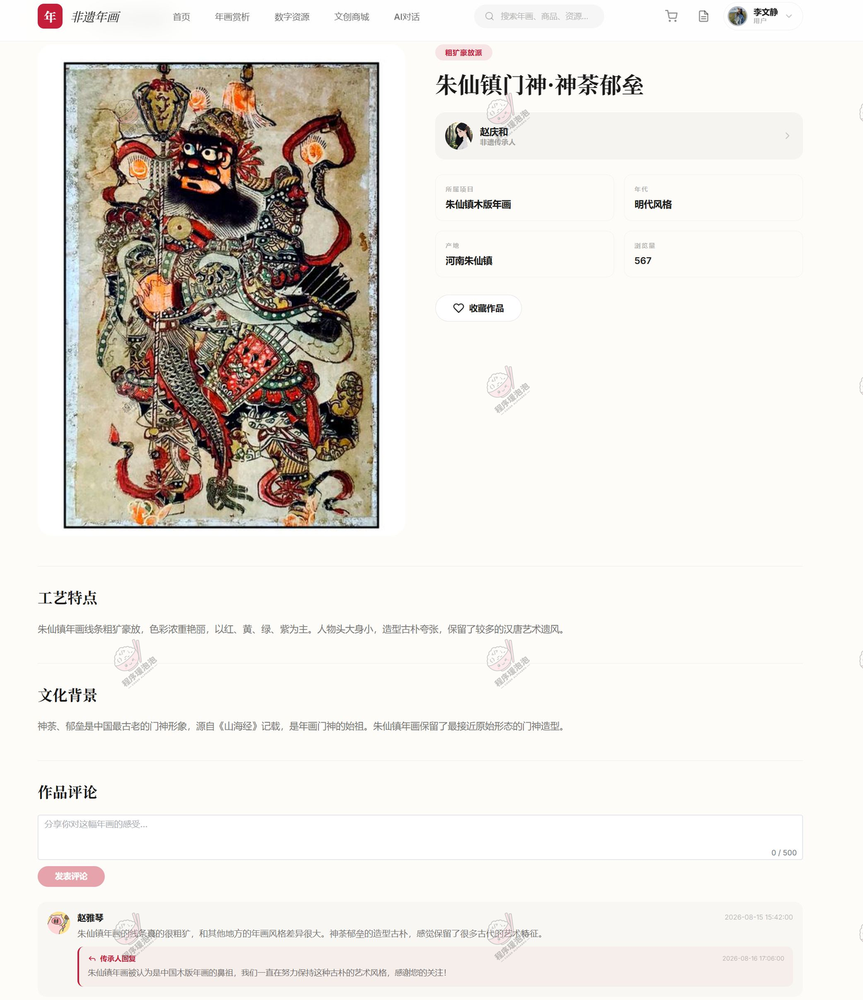

**数字资源馆**：按全部 / 图片资源 / 视频资源 / 图文资源筛，卡片左上角标类型、右下角是播放量（270、45、512 这种），图下写着资源名和所属作品。四条资源里有解说民俗符号的图文、有讲泥版制作工艺的视频，也有修复过程的视频。

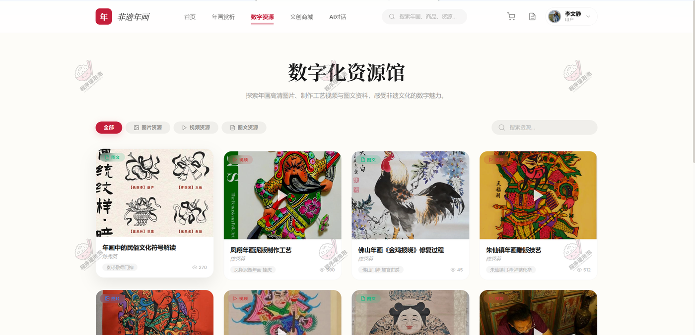

**文创商城**：分类是年画体验材料、年画文具生活、年画服饰配饰、年画原作 / 复刻。卡片上是商品图、名称、规格、价格和已售数量，比如年画艺术挂画（装裱版）50cm×70cm 实木装裱 ¥358.00、年画冰箱贴套装 6 枚 ¥45.00。

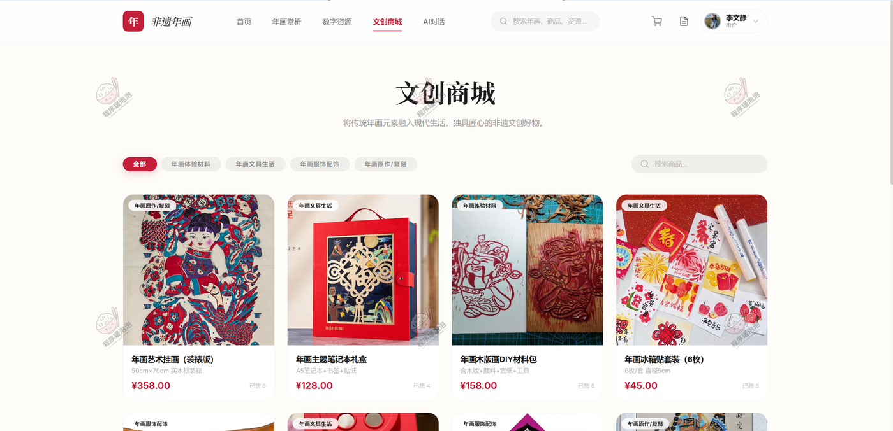

**文创详情**：左边商品大图，右边是分类标签、商品名、价格、规格、库存、传承人、关联作品（这里关联到佛山门神·加官进爵，可点进作品页），下面是数量加减和「加入购物车 / 立即购买」。

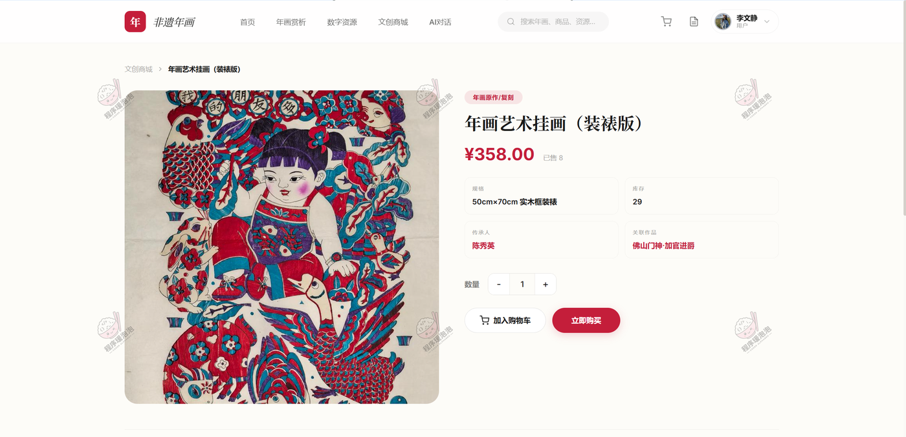

**AI 对话**：左侧会话列表可以新建、切换、删除，右侧是聊天区。截图里问的是「如果只买三类东西，优先买什么？」，回答按 1、2、3 排优先级，后面还补了一句预算有限时用复刻版替代手绘原作。上一轮的「放哪、怎么摆、配什么色」也还在上下文里。

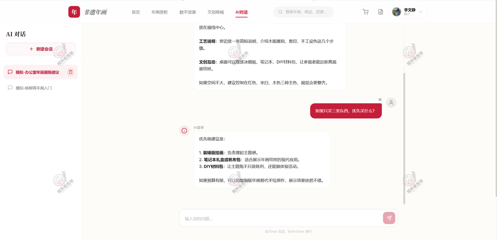

**购物车**：一行一个商品，带缩略图、名称、规格、单价、数量加减和删除；右侧订单摘要显示已选件数和合计，下面是「去结算」。

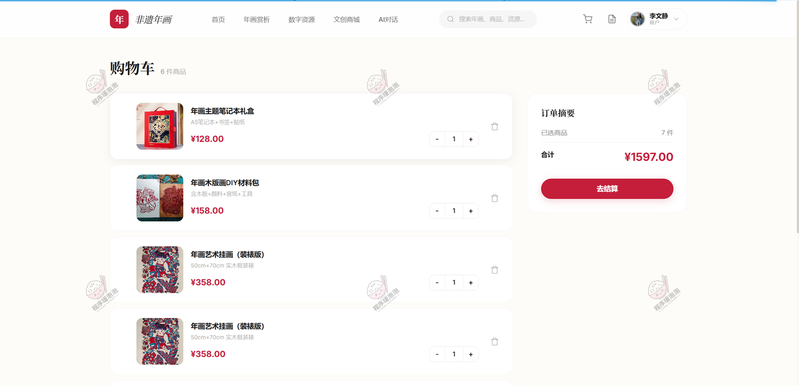

**我的订单**：顶部按全部、待支付、已支付、已发货、已收货、已退款、已取消分 tab，一单一块，显示订单号、状态标签、商品明细（名称、规格、单价、数量）、合计和「查看详情」。

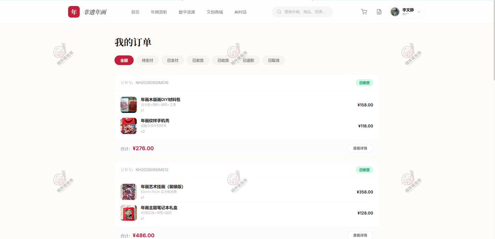

### 5.3 传承人端

**我的年画作品**：左侧菜单是个人中心、作品管理（我的作品 / 数字化资源）、商品管理（文创商品 / 订单管理）、互动管理（评论管理 / 评价管理）。列表按关键词、所属流派、是否发布筛，每行带作品图、作品名、所属项目、所属流派、年代、产地、浏览量、发布开关和修改 / 下架 / 删除。

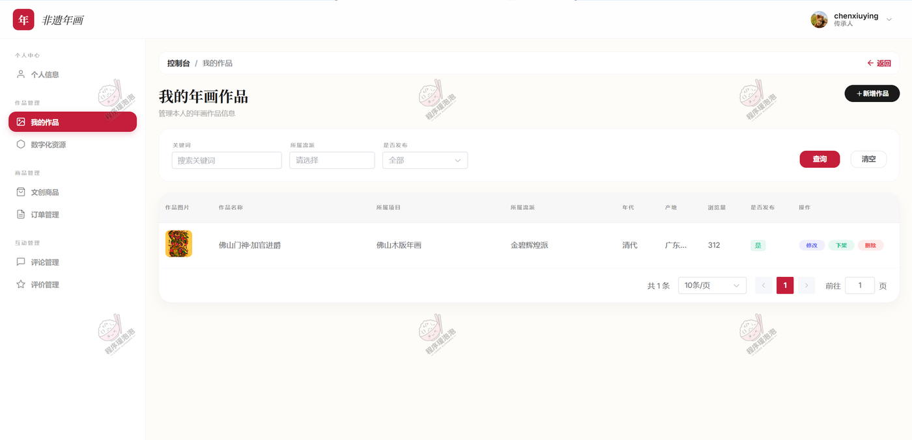

**我的数字化资源**：这张表把审核这件事说清楚了 —— 资源名、类型、关联作品、浏览量、审核状态、审核备注、操作。被驳回的那条备注写着「图片清晰度不足，请重新上传高清版本」，通过的两条分别备注了「学术价值较高」「展示了珍贵的传统技艺」，传承人不用问也知道问题在哪。

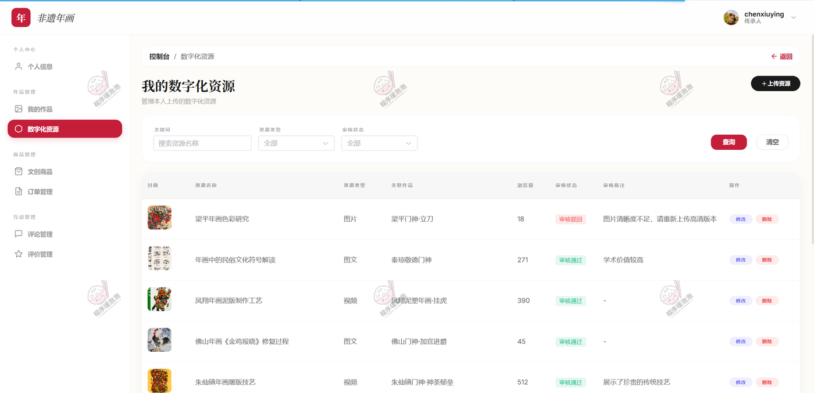

**我的文创商品**：商品图、名称、分类、售价、库存、销量、上架开关、操作。库存和销量能跟用户端对上：挂画这里库存 29、销量 8，商品详情页显示的也是库存 29、已售 8。

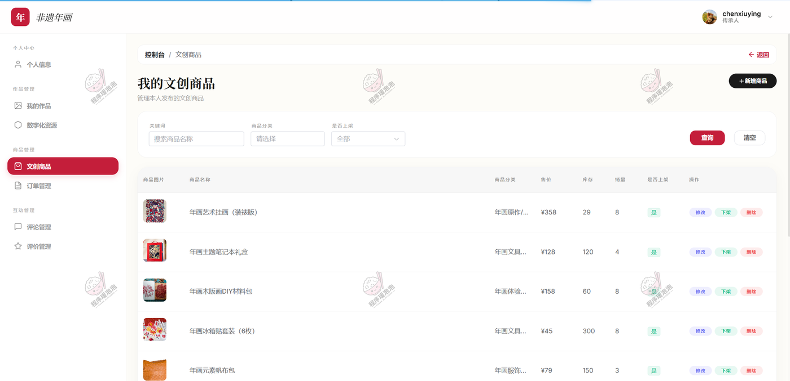

**我的订单管理**：只列本人商品收到的订单，字段有订单号、购买用户、收货人、联系电话、订单总额、订单状态、下单时间。状态是混着的：已收货、已退款、已支付、已发货、已取消都有，不同状态给的操作按钮不一样，已支付的能发货、待处理的能退款。

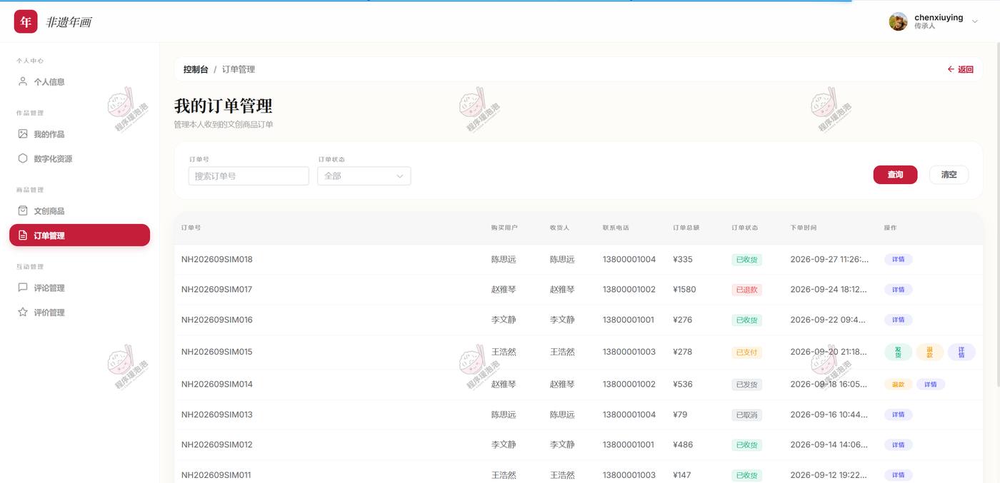

**商品评价管理**：按关联商品筛，每条评价列出用户、商品、评分（4 分、5 分）、评价内容、评价时间、回复内容。回复过的显示「修改回复」，没回复的显示「未回复」，用户写的「DIY材料包内容齐全，课堂体验很好，学生很喜欢」下面就有传承人的回复。

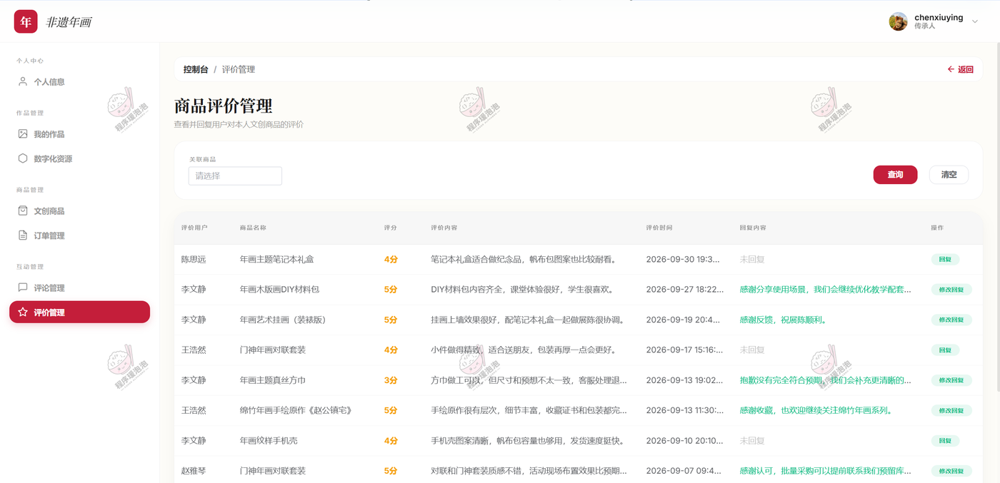

### 5.4 管理员端

**传承人审核**：账号、名称、手机号、擅长流派、从艺年限、资质证书、审核状态一列排开。资质证书那列有缩略图，点开能看大图；审核状态通过后是绿色标签，操作里还能进详情回看材料。

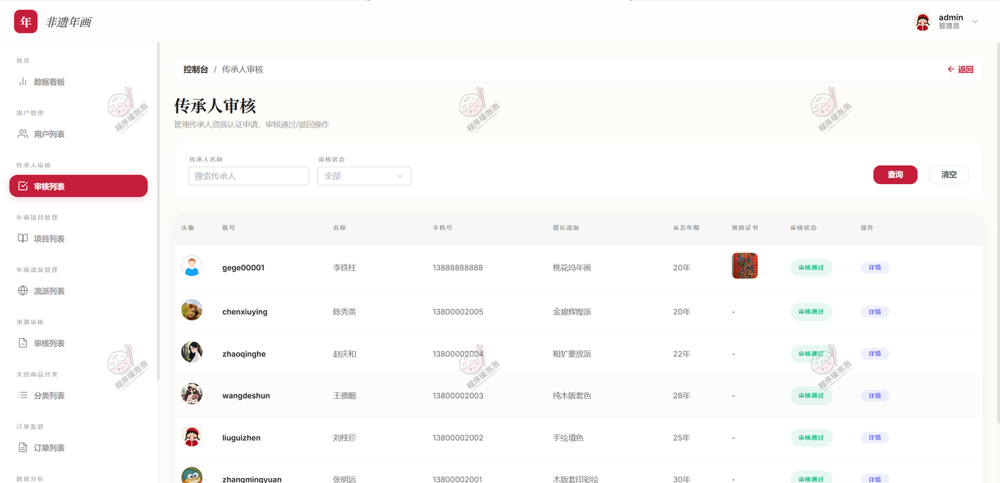

**年画项目**：项目名、所属地区、保护级别（国家级 / 省级）、项目简介（查看详情）、项目图片、排序序号。梁平、凤翔、朱仙镇、武强是国家级，佛山是省级，排序值决定前台的展示顺序。

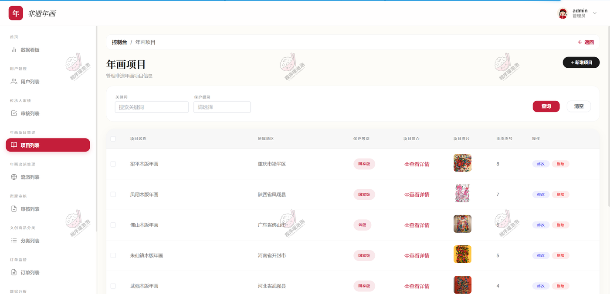

**年画流派**：六个流派一屏能看完，每个流派配发源地和排序 —— 古版质朴派在陕西凤翔、金碧辉煌派在广东佛山、粗犷豪放派在河南朱仙镇、手绘填色派在四川绵竹、纯木版套色派在江苏苏州、木版套印彩绘派在天津杨柳青。流派描述用「查看详情」展开。

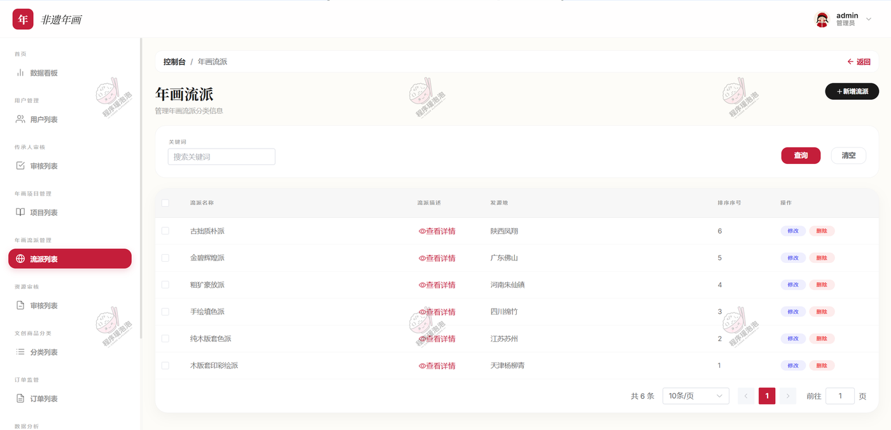

**资源审核**：跟传承人端的资源列表是同一批数据，这里多了「传承人」一列，方便按人追溯。资源名、类型、关联作品、浏览量、审核状态都在，驳回的那条依然是红色标签。

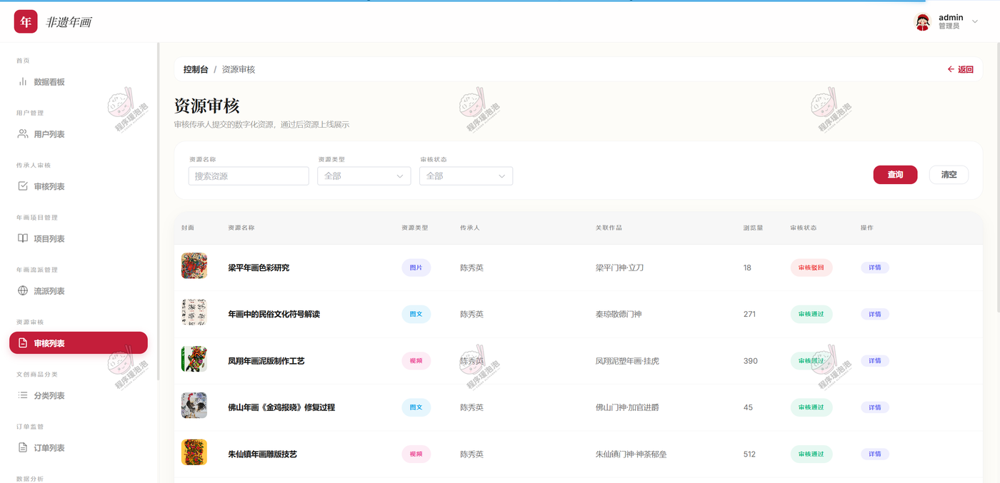

**订单监管**：顶部八张卡是平台交易概况 —— 28 总订单、¥11175.00 总销售额、0 待支付、6 已收货、5 已发货、12 已支付、2 已退款、3 已取消；下面是订单表，多出「传承人」和「实付金额」两列，说明钱最终落到哪位传承人头上，可按订单号、购买用户、传承人、状态和时间段筛。

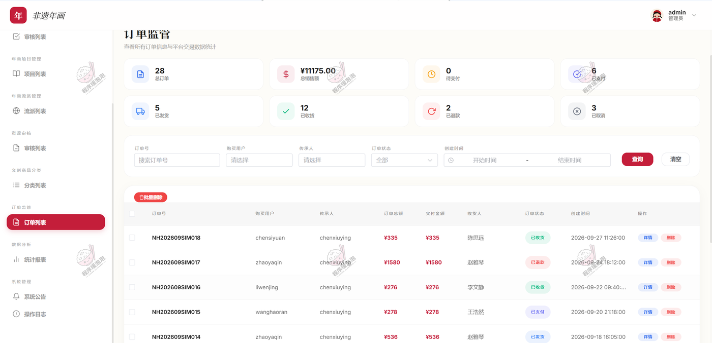

**统计报表**：上半部分是近 12 个月订单量与销售额的双线图，左轴订单量、右轴销售额，横轴从 2025-10 到 2026-09；下半部分左边是热门年画排行（连年有余、秦琼敬德门神、五子夺福、赵公明宝……），右边是热销商品排行（年画冰箱贴套装、年画木版画 DIY 材料包、年画艺术挂画……），都是横向条形图，长短一眼能比。

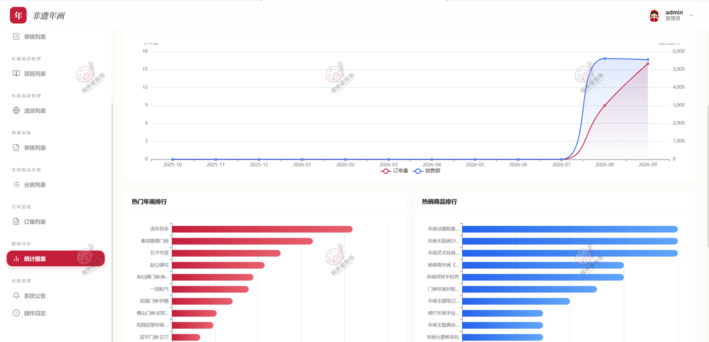

## 六、说明

- 截图中的账号、姓名、手机号、订单号均为演示数据。
- 后台与前台截图多为 2559 × 1238 的宽屏图，按原宽展示；年画详情页是 2084 × 2413 的竖长图，单张全宽，避免缩小后小字看不清。
- 文档展示 21 张截图，需要了解更多，请联系我。
